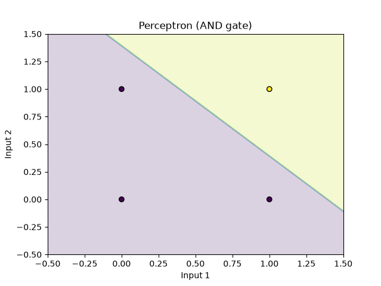

# Perceptron Forward Pass

This project demonstrates the forward pass of a single-layer perceptron using
NumPy. The perceptron is applied to the truth table of an AND gate and its
decision regions are visualized with Matplotlib.

## What the program does

The program implements three core operations:

1. **Linear combination**: calculates the weighted sum of the inputs and adds
   the bias.
2. **Step activation**: returns `1` when the result is greater than or equal
   to zero, and `0` otherwise.
3. **Perceptron forward pass**: applies the two operations to every input
   vector and returns the predictions.

For an input vector \(x\), weight vector \(w\), and bias \(b\), the perceptron
computes:

```text
z = x · w + b
prediction = 1 if z >= 0, otherwise 0
```

The example uses the following AND-gate inputs and labels:

| Input 1 | Input 2 | Expected label |
|--------:|--------:|---------------:|
| 0       | 0       | 0              |
| 0       | 1       | 0              |
| 1       | 0       | 0              |
| 1       | 1       | 1              |

## Requirements

- Python 3
- NumPy
- scikit-learn
- Matplotlib

## Installation

From the project directory, create and activate a virtual environment:

```bash
python3 -m venv venv
source venv/bin/activate
```

Install the required packages:

```bash
python -m pip install numpy scikit-learn matplotlib
```

## Running the program

Run the script while the virtual environment is active:

```bash
python forward_pass.py
```

The program prints the predictions for two manually selected sets of weights,
then runs ten experiments with randomly generated weights and reports the
accuracy of each experiment. It also displays a plot of the perceptron's
decision regions.

## Expected result

The deterministic part of the output is:

```text
Predictions: [0, 0, 0, 1]
New predictions: [0, 1, 1, 1]
```

The ten experiment results vary between executions because the weights are
generated randomly. A typical experiment may look like this:

```text
Experiment 1
Weights: [0.39842314 0.49939431]
Predictions: [0, 0, 0, 1]
Accuracy: 100.00%
```

Other random weights may produce predictions such as `[0, 0, 0, 0]`, which
gives an accuracy of `75.00%` for the AND labels. This is expected: the
program evaluates randomly initialized weights; it does not train the
perceptron.

The final plot shows the two prediction regions separated by the perceptron's
linear decision boundary:



## Project files

- `forward_pass.py`: perceptron implementation, experiments, accuracy
  evaluation, and visualization.
- `Figure_1.png`: visualization of the perceptron's decision regions for the
  AND gate.
- `Lab_2_(Perceptron_forward_pass).ipynb`: notebook version of the laboratory
  exercise.

## Deactivating the virtual environment

When finished, deactivate the environment with:

```bash
deactivate
```
